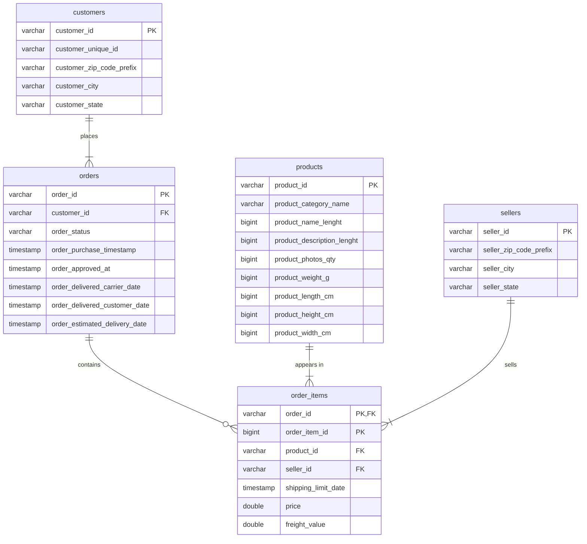

# kddm_lab

Lab work for SWEN466 Knowledge Discovery and Data Mining, BITS College.

## Assignment 1: Data Quality Analysis and ERD Design

- `notebooks/01_explore_source_data.ipynb` - SQL checks on the Olist tables (grain, primary keys, foreign keys, cardinality and exercises 1-5)
- `erd/olist_erd.png` - ERD in crow's foot notation, made with Mermaid (source in `erd/olist_erd.mmd`)
- `NOTE.md` - short note



## How to run

Put the five Olist CSV files in `data/raw/`, then:

```
pip install -r requirements.txt
cd notebooks
jupyter notebook 01_explore_source_data.ipynb
```

The notebook creates the DuckDB file in `data/warehouse/`. It needs duckdb 1.x, the loading cells don't work on 2.0.
